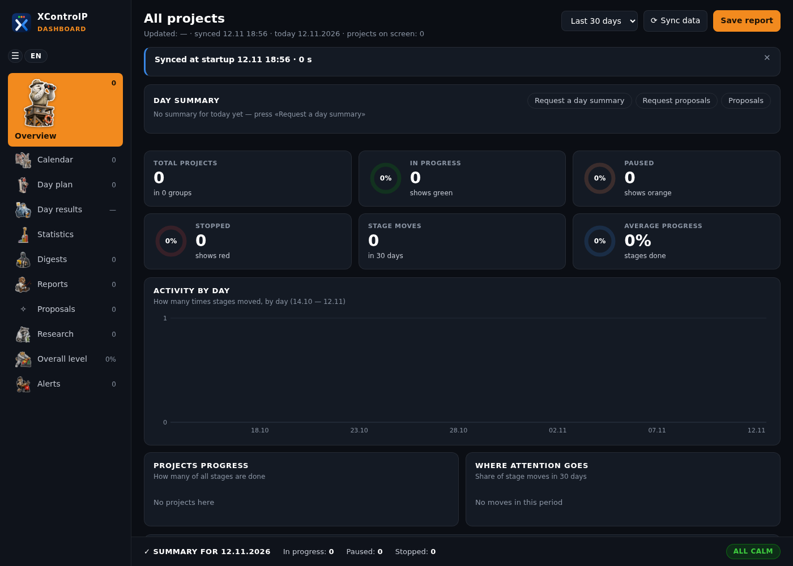

[English](README.md) · [Русский](README.ru.md) · **עברית**

# XControlP: לוח בקרה אישי לפרויקטים

XControlP הוא לוח בקרה במחשב לפרויקטים שלכם. בחלון אחד רואים איפה עומד כל פרויקט, מה זז לאחרונה, את תוכנית היום, רעיונות, מחקרים ודוחות. החלון עובד בעברית, באנגלית וברוסית.

התוכנה רצה על המחשב שלכם ושומרת את כל הנתונים בקבצים רגילים לידה. אין שרת חיצוני ואין חשבון: התוכנה מפעילה שרת אינטרנט קטן שרק המחשב הזה יכול לגשת אליו (`127.0.0.1`). הנתונים יוצאים מהמחשב רק דרך מה שאתם מחברים בעצמכם: Google Calendar, מאגרי git ועוזר הבינה המלאכותית. עוזר בענן, כמו Claude, שולח לספק שלו את מה שהוא קורא. פרטים: [מה יוצא מהמחשב](docs/he/assistant.md#10-מה-יוצא-מהמחשב).

XControlP נבנה כדי לנהל אותו יחד עם עוזר בינה מלאכותית, למשל Claude. אתם מספרים לעוזר מה קרה; העוזר מעדכן את קובצי הנתונים; החלון מציג את התוצאה. אפשר גם לערוך את הקבצים ביד.

## מה הוא עושה

- **פרויקטים לפי קבוצות.** לכל פרויקט יש שלבים, שלב נוכחי, סטטוס ותאריך התנועה האחרונה. ההתקדמות יכולה להגיע ממאגר git או מקובץ התקדמות, ואז הלוח מתעדכן בעצמו בלחיצה על **לסנכרן נתונים** (ופעם אחת בכל הפעלה).
- **התראות.** פרויקט בלי תנועה שבועיים, השהיה ארוכה, פרויקט שנעצר, משימה שמועברת שוב ושוב.
- **תוכנית היום וסיכומי ימים.** משימות היום מתוך הפרויקטים, עדיפויות, בוצע או הועבר; סוגרים את היום בציון מ-1 עד 10.
- **סטטיסטיקה** לשבוע, לחודש, לרבעון ולשנה.
- **יומן.** יומני Google שלכם, לקריאה בלבד (לא חובה).
- **רעיונות** מקובצי Markdown, עם סטטוסים, היסטוריה וסטטיסטיקה; רעיונות שאתם מציעים כשירותים.
- **מחקרים, דוחות והצעות** שהעוזר מכין, בשלוש שפות.
- **הגדרות:** שפה (בעברית החלון מוצג מימין לשמאל), ערכת נושא כהה או בהירה, גודל טקסט, צבע הדגשה, שני סגנונות סמלים.

## מה צריך

- Windows 10 או 11 ו-Microsoft Edge (הלוח נפתח כחלון-אפליקציה של Edge; בלי Edge, בדפדפן ברירת המחדל).
- Python 3.10 ומעלה מ-[python.org](https://www.python.org/downloads/). לא צריך חבילות נוספות.
- Git, רק אם ההתקדמות של הפרויקטים מגיעה ממאגרי git.

## התחלה מהירה

1. מורידים את XControlP: `git clone https://github.com/XThoughtLabs/XControlP.git`, או **Code → Download ZIP** ופורסים, למשל אל `C:\Users\<you>\XControlP`.
2. לוחצים פעמיים על `create_shortcut.pyw`. על שולחן העבודה מופיע קיצור דרך **XControlP**.
3. פותחים את קיצור הדרך. בהפעלה הראשונה נוצר `projects.json` ריק מתוך `templates/projects.example.json`, והחלון נפתח.
4. מוסיפים פרויקטים: עורכים את `projects.json` ([הגדרה](docs/he/setup.md)) או מבקשים מהעוזר ([עבודה עם עוזר](docs/he/assistant.md)).

אם קיצור הדרך לא עולה, לוחצים פעמיים על `start_fallback.cmd`.

## הנתונים שלכם נשארים שלכם

הנתונים נמצאים בקבצים לצד התוכנה: `projects.json`, תוכנית היום `day.db`, היומן, בקשות ותשובות, מחקרים וכן הלאה. כולם רשומים ב-`.gitignore`, ולכן עותק של XControlP ב-git לא יכניס אותם ל-commit. אל תפרסמו את הקבצים האלה.

## תיעוד

| | English | Русский | עברית |
|---|---|---|---|
| הגדרה: התקנה, פרויקטים, מקורות התקדמות, יומן | [setup](docs/en/setup.md) | [настройка](docs/ru/setup.md) | [הגדרה](docs/he/setup.md) |
| שימוש בחלון | [using](docs/en/using.md) | [работа с окном](docs/ru/using.md) | [שימוש בחלון](docs/he/using.md) |
| עבודה עם עוזר בינה מלאכותית | [assistant](docs/en/assistant.md) | [ассистент](docs/ru/assistant.md) | [עוזר](docs/he/assistant.md) |

כללים לעוזר בינה מלאכותית שעובד בתיקייה הזאת: [AGENTS.md](AGENTS.md) (באנגלית).

## רישיון

Apache License 2.0, ראו [LICENSE](LICENSE) ו-[NOTICE](NOTICE).
Copyright 2026 Vladislav Braiman (XThoughtLabs). חלק מהקוד נכתב בעזרת עוזרי בינה מלאכותית לתכנות.
