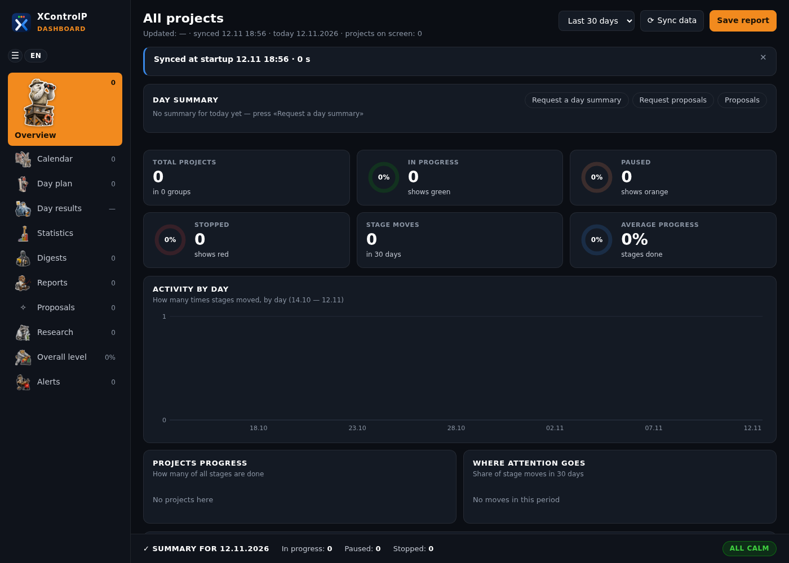

**English** · [Русский](README.ru.md) · [עברית](README.he.md)

# XControlP: a personal project dashboard

XControlP is a desktop dashboard for your own projects. One window shows where each project stands, what moved recently, your plan for the day, your ideas, research and reports. The window works in English, Russian or Hebrew.

It runs on your computer and keeps all data in plain files next to the program. There is no outside server and no account: the program starts a small web server that only this computer can reach (`127.0.0.1`). Your data leaves the computer only through what you connect yourself: Google Calendar, git repositories and your AI assistant. A cloud assistant, such as Claude, sends what it reads to its provider. Details: [What leaves your computer](docs/en/assistant.md#10-what-leaves-your-computer).

XControlP is built to be kept together with an AI assistant, for example Claude. You tell the assistant what happened; the assistant updates the data files; the window shows the result. You can also edit the files by hand.

## What it does

- **Projects by groups.** Each project has stages, a current stage, a status and the date it last moved. Progress can come from a git repository or a progress file, so the dashboard updates itself when you press **Sync data** (and once at every start).
- **Alerts.** A project with no movement for two weeks, a long pause, a stopped project, a task carried over again and again.
- **Day plan and day results.** Tasks of the day from your projects, priorities, done or carried over; close the day with a rating from 1 to 10.
- **Statistics** for a week, month, quarter and year.
- **Calendar.** Your Google calendars, read-only (optional).
- **Ideas** from Markdown files, with statuses, history and statistics; ideas you offer as services.
- **Research, reports and proposals** prepared by your assistant, in three languages.
- **Settings:** language (the window mirrors for Hebrew), dark or light theme, text size, accent colour, two icon styles.

## Requirements

- Windows 10 or 11 with Microsoft Edge (the dashboard opens as an Edge app window; without Edge it opens in your default browser).
- Python 3.10 or newer from [python.org](https://www.python.org/downloads/). No extra packages.
- Git, only if your projects take their progress from git repositories.

## Quick start

1. Download XControlP: `git clone https://github.com/XThoughtLabs/XControlP.git`, or **Code → Download ZIP** and unpack it, for example to `C:\Users\<you>\XControlP`.
2. Double-click `create_shortcut.pyw`. A shortcut **XControlP** appears on your desktop.
3. Open the shortcut. The first start creates an empty `projects.json` from `templates/projects.example.json`, and the window opens.
4. Add your projects: edit `projects.json` ([Setup](docs/en/setup.md)) or ask your assistant ([Working with an assistant](docs/en/assistant.md)).

If the shortcut does not start, double-click `start_fallback.cmd`.

## Your data stays yours

Your data lives in files next to the program: `projects.json`, the day plan `day.db`, the calendar, requests and answers, research and so on. All of them are listed in `.gitignore`, so a copy of XControlP kept in git does not commit them. Do not publish these files.

## Documentation

| | English | Русский | עברית |
|---|---|---|---|
| Setup: install, projects, progress sources, calendar | [setup](docs/en/setup.md) | [настройка](docs/ru/setup.md) | [הגדרה](docs/he/setup.md) |
| Using the window | [using](docs/en/using.md) | [работа с окном](docs/ru/using.md) | [שימוש בחלון](docs/he/using.md) |
| Working with an AI assistant | [assistant](docs/en/assistant.md) | [ассистент](docs/ru/assistant.md) | [עוזר](docs/he/assistant.md) |

Rules for an AI assistant working in this folder: [AGENTS.md](AGENTS.md).

## License

Apache License 2.0, see [LICENSE](LICENSE) and [NOTICE](NOTICE).
Copyright 2026 Vladislav Braiman (XThoughtLabs). Parts of the code were written with the help of AI coding assistants.
