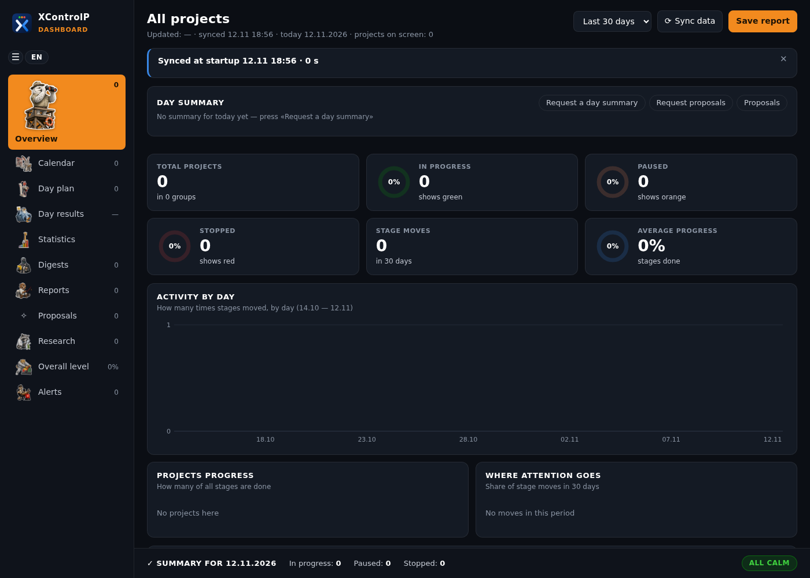

**English** · [Русский](README.ru.md) · [עברית](README.he.md)

# XControlP: a personal project dashboard

XControlP is a desktop dashboard for your own projects. One window shows where each project stands, what moved recently, your plan for the day, your ideas, research and reports. The window works in English, Russian or Hebrew.

It runs on your computer and keeps all data in plain files next to the program. There is no outside server and no account: the program starts a small web server that only this computer can reach (`127.0.0.1`). Your data leaves the computer only through what you connect yourself: Google Calendar, git repositories and your AI assistant. A cloud assistant, such as Claude, sends what it reads to its provider. Details: [What leaves your computer](docs/en/assistant.md#10-what-leaves-your-computer).

XControlP is built to be kept together with an AI assistant, for example Claude. You tell the assistant what happened; the assistant updates the data files; the window shows the result. You can also edit the files by hand.

## What it does

- **Projects by groups.** Each project has stages, a current stage, a status and the date it last moved. Progress can come from a git repository or a progress file, so the dashboard updates itself when you press **Sync data** (and once at every start).
- **Alerts.** A project with no movement for two weeks, a long pause, a stopped project, a task carried over again and again.
- **Day plan and day results.** Tasks of the day from your projects, priorities, done or carried over; close the day with a rating from 1 to 10.
- **Statistics** for a week, month, quarter and year.
- **Calendar.** Your Google calendars, read-only (optional).
- **Ideas** from Markdown files, with statuses, history and statistics; ideas you offer as services.
- **Research, reports and proposals** prepared by your assistant, in three languages.
- **Daily news digests** (optional): a scheduled task of your assistant writes a digest of the news on your topics into a git repository of your own every morning; you mark items «interesting» or «useful», collect them and ask for ideas for your projects.
- **Settings:** language (the window mirrors for Hebrew), dark or light theme, text size, accent colour, two icon styles.

## Requirements

- Windows 10 or 11 with Microsoft Edge (the dashboard opens as an Edge app window; without Edge it opens in your default browser).
- Python 3.10 or newer from [python.org](https://www.python.org/downloads/). No extra packages.
- Git, only if your projects take their progress from git repositories.

## Quick start

1. Download XControlP: `git clone https://github.com/XThoughtLabs/XControlP.git`, or **Code → Download ZIP** and unpack it, for example to `C:\Users\<you>\XControlP`.
2. Double-click `create_shortcut.pyw`. A shortcut **XControlP** appears on your desktop.
3. Open the shortcut. The first start creates an empty `projects.json` from `templates/projects.example.json`, and the window opens.
4. Add your projects: edit `projects.json` ([Setup](docs/en/setup.md)) or ask your assistant ([Working with an assistant](docs/en/assistant.md)).

If the shortcut does not start, double-click `start_fallback.cmd`.

## Your data stays yours

Your data lives in files next to the program: `projects.json`, the day plan `day.db`, the calendar, requests and answers, research and so on. All of them are listed in `.gitignore`, so a copy of XControlP kept in git does not commit them. Do not publish these files.

## How the daily digest is built

1. You create a private git repository for the digests and set `digest_repo` in `projects.json`.
2. Every morning a scheduled task of your AI assistant (for example, a scheduled task in Claude Code) searches the news on your topics, reads each page itself and writes `digests/YYYY/MM/YYYY-MM-DD.json`: 5 to 8 items, each with a summary, a line on why it matters to you, a link and the publication date; what it could not confirm goes under «Not verified». It commits and pushes the file to `main`.
3. **Sync data** brings the new digest into the window. Your «interesting» and «useful» marks are committed and pushed to the same repository.
4. The **Interesting** and **Useful** tabs collect the marked items; **Ideas for your projects** asks your assistant what they mean for your projects, and the answer comes as proposals.

The file format, a ready text for the morning task and what to check: [Daily digest](docs/en/digests.md). Templates: [`templates/digest-task.example.md`](templates/digest-task.example.md), [`templates/digest.example.json`](templates/digest.example.json).

## Updates

XControlP is in active development: new versions come out regularly on the `main` branch.

- **Follow the project:** on GitHub, press **Watch** (for example **All Activity**) to be notified of new commits, or **Star** to keep the project in your list.
- **The update check in the program** (for a folder that is a git clone): switch it on in **Settings** → **Updates**. The program then tells you when a new version is out, updates only when you press **Update the program**, and does not touch your data files. It is off by default. Details: [Setup, section 9](docs/en/setup.md#9-updating-xcontrolp).
- **By hand:** `git pull` in the folder, with the window closed. For a fork on GitHub: **Sync fork** on your fork's page, then `git pull`.
- **Fully automatic:** git has no built-in automatic update of a clone. If you want one, a task in Windows Task Scheduler can run `git -C <your folder> pull --ff-only` on a schedule while the window is closed. The update check in the program is the safer way: it never replaces a file of yours, even if a new version brings a file at the same path, and a plain `git pull` may.

## Documentation

| | English | Русский | עברית |
|---|---|---|---|
| Setup: install, projects, progress sources, calendar | [setup](docs/en/setup.md) | [настройка](docs/ru/setup.md) | [הגדרה](docs/he/setup.md) |
| Using the window | [using](docs/en/using.md) | [работа с окном](docs/ru/using.md) | [שימוש בחלון](docs/he/using.md) |
| Working with an AI assistant | [assistant](docs/en/assistant.md) | [ассистент](docs/ru/assistant.md) | [עוזר](docs/he/assistant.md) |
| Daily news digest: repository, file format, the morning task | [digests](docs/en/digests.md) | [сводки](docs/ru/digests.md) | [סיכומים](docs/he/digests.md) |

Rules for an AI assistant working in this folder: [AGENTS.md](AGENTS.md).

## License

Apache License 2.0, see [LICENSE](LICENSE) and [NOTICE](NOTICE).
Copyright 2026 Vladislav Braiman (XThoughtLabs). Parts of the code were written with the help of AI coding assistants.
