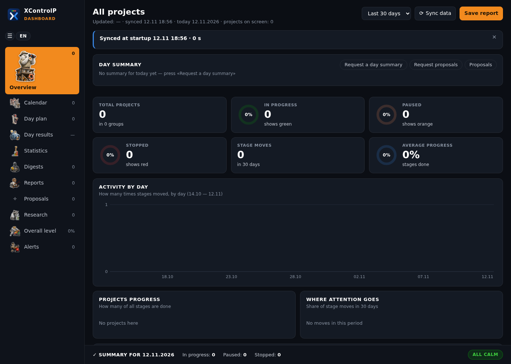

[English](README.md) · **Русский** · [עברית](README.he.md)

# XControlP: личный пульт проектов

XControlP — пульт для ваших собственных проектов на компьютере. В одном окне видно, где сейчас каждый проект, что сдвинулось за последнее время, план на день, идеи, исследования и отчёты. Окно работает на русском, английском и иврите.

Программа работает на вашем компьютере и хранит все данные в обычных файлах рядом с собой. Внешнего сервера и учётной записи нет: программа запускает маленький веб-сервер, доступный только с этого компьютера (`127.0.0.1`). Данные уходят с компьютера только через то, что вы подключаете сами: Google Календарь, репозитории git и ИИ-ассистента. Облачный ассистент, например Claude, передаёт своему поставщику то, что читает. Подробнее: [Что уходит с компьютера](docs/ru/assistant.md#10-что-уходит-с-компьютера).

XControlP задуман так, чтобы вести его вместе с ИИ-ассистентом, например Claude. Вы рассказываете ассистенту, что произошло; ассистент обновляет файлы данных; окно показывает результат. Файлы можно править и вручную.

## Что умеет

- **Проекты по группам.** У проекта есть этапы, текущий этап, статус и дата последнего движения. Продвижение может браться из репозитория git или из файла продвижения: тогда пульт обновляется сам по кнопке **Синхронизировать данные** (и один раз при каждом запуске).
- **Тревоги.** Проект без движения две недели, долгая пауза, остановленный проект, задача, которую снова и снова переносят.
- **План дня и итоги дней.** Задачи дня из ваших проектов, приоритеты, сделано или перенесено; день закрывается оценкой от 1 до 10.
- **Статистика** за неделю, месяц, квартал и год.
- **Календарь.** Ваши календари Google, только чтение (по желанию).
- **Идеи** из файлов Markdown — со статусами, историей и статистикой; идеи, которые вы предлагаете как услуги.
- **Исследования, отчёты и предложения**, которые готовит ассистент, на трёх языках.
- **Ежедневные сводки новостей** (по желанию): задача вашего ассистента по расписанию каждое утро пишет сводку новостей на ваши темы в ваш собственный репозиторий git; вы отмечаете пункты «интересно» или «полезно», собираете их и просите идеи для своих проектов.
- **Настройки:** язык (для иврита окно зеркалится), тёмная или светлая тема, размер текста, цвет акцента, два стиля значков.

## Что нужно

- Windows 10 или 11 и Microsoft Edge (пульт открывается окном-приложением Edge; без Edge — в браузере по умолчанию).
- Python 3.10 или новее с [python.org](https://www.python.org/downloads/). Дополнительные пакеты не нужны.
- Git — только если продвижение проектов берётся из репозиториев git.

## Быстрый старт

1. Скачайте XControlP: `git clone https://github.com/XThoughtLabs/XControlP.git` или **Code → Download ZIP** и распакуйте, например в `C:\Users\<вы>\XControlP`.
2. Дважды щёлкните `create_shortcut.pyw`. На рабочем столе появится ярлык **XControlP**.
3. Откройте ярлык. При первом запуске из `templates/projects.example.json` создаётся пустой `projects.json`, и открывается окно.
4. Добавьте проекты: отредактируйте `projects.json` ([Настройка](docs/ru/setup.md)) или попросите ассистента ([Работа с ассистентом](docs/ru/assistant.md)).

Если ярлык не запускается, дважды щёлкните `start_fallback.cmd`.

## Ваши данные остаются вашими

Данные лежат в файлах рядом с программой: `projects.json`, план дня `day.db`, календарь, запросы и ответы, исследования и так далее. Все они перечислены в `.gitignore`, поэтому копия XControlP в git их не закоммитит. Не публикуйте эти файлы.

## Как строится ежедневная сводка новостей

1. Вы создаёте приватный репозиторий git для сводок и задаёте `digest_repo` в `projects.json`.
2. Каждое утро задача вашего ИИ-ассистента по расписанию (например, задача по расписанию в Claude Code) ищет новости на ваши темы, сама читает каждую страницу и пишет `digests/ГГГГ/ММ/ГГГГ-ММ-ДД.json`: от 5 до 8 пунктов, у каждого суть, строка о том, почему это важно вам, ссылка и дата публикации; то, что не удалось подтвердить, идёт в «Не проверено». Задача делает коммит и push файла в `main`.
3. **Синхронизировать данные** приносит новую сводку в окно. Ваши отметки «интересно» и «полезно» коммитятся и отправляются в тот же репозиторий.
4. Вкладки **Интересное** и **Полезное** собирают отмеченные пункты; **Идеи для моих проектов** просит ассистента сказать, что они значат для ваших проектов, и ответ приходит предложениями.

Формат файла, готовый текст утренней задачи и что проверить: [Ежедневная сводка](docs/ru/digests.md). Шаблоны: [`templates/digest-task.example.md`](templates/digest-task.example.md) (на английском), [`templates/digest.example.json`](templates/digest.example.json).

## Обновления

XControlP развивается: новые версии регулярно выходят в ветке `main`.

- **Следить за проектом:** на GitHub нажмите **Watch** (например, **All Activity**), чтобы получать уведомления о новых коммитах, или **Star**, чтобы проект остался в вашем списке.
- **Проверка обновлений в программе** (для папки-клона git): включите её в **Настройках** → **Обновления**. Программа сама скажет, что вышла новая версия, обновится только по кнопке **Обновить программу** и не тронет ваши файлы данных. По умолчанию проверка выключена. Подробно: [Настройка, раздел 9](docs/ru/setup.md#9-обновление-xcontrolp).
- **Вручную:** `git pull` в папке, при закрытом окне. Для форка на GitHub: **Sync fork** на странице вашего форка, потом `git pull`.
- **Полностью автоматически:** встроенного автообновления клона у git нет. Если оно нужно, задание в Планировщике заданий Windows может по расписанию запускать `git -C <ваша папка> pull --ff-only`, пока окно закрыто. Надёжнее проверка в программе: она никогда не заменит ваш файл, даже если новая версия принесёт файл с тем же путём, а обычный `git pull` может.

## Документация

| | English | Русский | עברית |
|---|---|---|---|
| Настройка: установка, проекты, источники продвижения, календарь | [setup](docs/en/setup.md) | [настройка](docs/ru/setup.md) | [הגדרה](docs/he/setup.md) |
| Работа с окном | [using](docs/en/using.md) | [работа с окном](docs/ru/using.md) | [שימוש בחלון](docs/he/using.md) |
| Работа с ИИ-ассистентом | [assistant](docs/en/assistant.md) | [ассистент](docs/ru/assistant.md) | [עוזר](docs/he/assistant.md) |
| Ежедневная сводка новостей: репозиторий, формат файла, утренняя задача | [digests](docs/en/digests.md) | [сводки](docs/ru/digests.md) | [סיכומים](docs/he/digests.md) |

Правила для ИИ-ассистента, работающего в этой папке: [AGENTS.md](AGENTS.md) (на английском).

## Лицензия

Apache License 2.0, см. [LICENSE](LICENSE) и [NOTICE](NOTICE).
Copyright 2026 Vladislav Braiman (XThoughtLabs). Часть кода написана с помощью ИИ-ассистентов для программирования.
