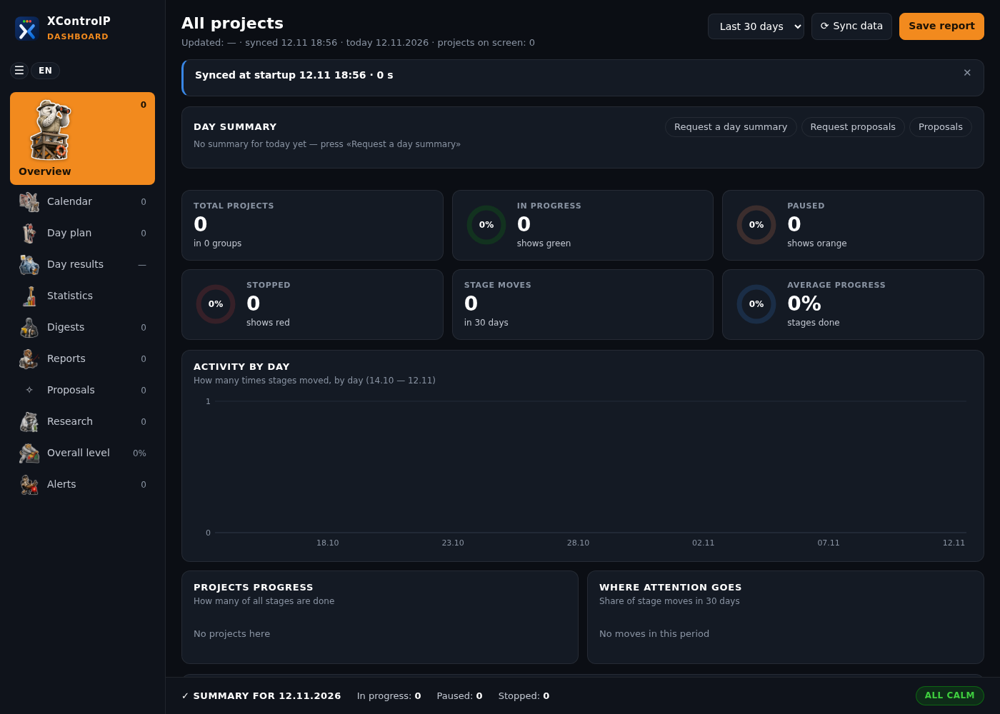

[English](README.md) · **Русский** · [עברית](README.he.md)

# XControlP: личный пульт проектов

XControlP — пульт для ваших собственных проектов на компьютере. В одном окне видно, где сейчас каждый проект, что сдвинулось за последнее время, план на день, идеи, исследования и отчёты. Окно работает на русском, английском и иврите.

Программа работает на вашем компьютере и хранит все данные в обычных файлах рядом с собой. Внешнего сервера и учётной записи нет: программа запускает маленький веб-сервер, доступный только с этого компьютера (`127.0.0.1`). Данные уходят с компьютера только через то, что вы подключаете сами: Google Календарь, репозитории git и ИИ-ассистента. Облачный ассистент, например Claude, передаёт своему поставщику то, что читает. Подробнее: [Что уходит с компьютера](docs/ru/assistant.md#10-что-уходит-с-компьютера).

XControlP задуман так, чтобы вести его вместе с ИИ-ассистентом, например Claude. Вы рассказываете ассистенту, что произошло; ассистент обновляет файлы данных; окно показывает результат. Файлы можно править и вручную.

## Что умеет

- **Проекты по группам.** У проекта есть этапы, текущий этап, статус и дата последнего движения. Продвижение может браться из репозитория git или из файла продвижения: тогда пульт обновляется сам по кнопке **Синхронизировать данные** (и один раз при каждом запуске).
- **Тревоги.** Проект без движения две недели, долгая пауза, остановленный проект, задача, которую снова и снова переносят.
- **План дня и итоги дней.** Задачи дня из ваших проектов, приоритеты, сделано или перенесено; день закрывается оценкой от 1 до 10.
- **Статистика** за неделю, месяц, квартал и год.
- **Календарь.** Ваши календари Google, только чтение (по желанию).
- **Идеи** из файлов Markdown — со статусами, историей и статистикой; идеи, которые вы предлагаете как услуги.
- **Исследования, отчёты и предложения**, которые готовит ассистент, на трёх языках.
- **Настройки:** язык (для иврита окно зеркалится), тёмная или светлая тема, размер текста, цвет акцента, два стиля значков.

## Что нужно

- Windows 10 или 11 и Microsoft Edge (пульт открывается окном-приложением Edge; без Edge — в браузере по умолчанию).
- Python 3.10 или новее с [python.org](https://www.python.org/downloads/). Дополнительные пакеты не нужны.
- Git — только если продвижение проектов берётся из репозиториев git.

## Быстрый старт

1. Скачайте XControlP: `git clone https://github.com/XThoughtLabs/XControlP.git` или **Code → Download ZIP** и распакуйте, например в `C:\Users\<вы>\XControlP`.
2. Дважды щёлкните `create_shortcut.pyw`. На рабочем столе появится ярлык **XControlP**.
3. Откройте ярлык. При первом запуске из `templates/projects.example.json` создаётся пустой `projects.json`, и открывается окно.
4. Добавьте проекты: отредактируйте `projects.json` ([Настройка](docs/ru/setup.md)) или попросите ассистента ([Работа с ассистентом](docs/ru/assistant.md)).

Если ярлык не запускается, дважды щёлкните `start_fallback.cmd`.

## Ваши данные остаются вашими

Данные лежат в файлах рядом с программой: `projects.json`, план дня `day.db`, календарь, запросы и ответы, исследования и так далее. Все они перечислены в `.gitignore`, поэтому копия XControlP в git их не закоммитит. Не публикуйте эти файлы.

## Документация

| | English | Русский | עברית |
|---|---|---|---|
| Настройка: установка, проекты, источники продвижения, календарь | [setup](docs/en/setup.md) | [настройка](docs/ru/setup.md) | [הגדרה](docs/he/setup.md) |
| Работа с окном | [using](docs/en/using.md) | [работа с окном](docs/ru/using.md) | [שימוש בחלון](docs/he/using.md) |
| Работа с ИИ-ассистентом | [assistant](docs/en/assistant.md) | [ассистент](docs/ru/assistant.md) | [עוזר](docs/he/assistant.md) |

Правила для ИИ-ассистента, работающего в этой папке: [AGENTS.md](AGENTS.md) (на английском).

## Лицензия

Apache License 2.0, см. [LICENSE](LICENSE) и [NOTICE](NOTICE).
Copyright 2026 Vladislav Braiman (XThoughtLabs). Часть кода написана с помощью ИИ-ассистентов для программирования.
